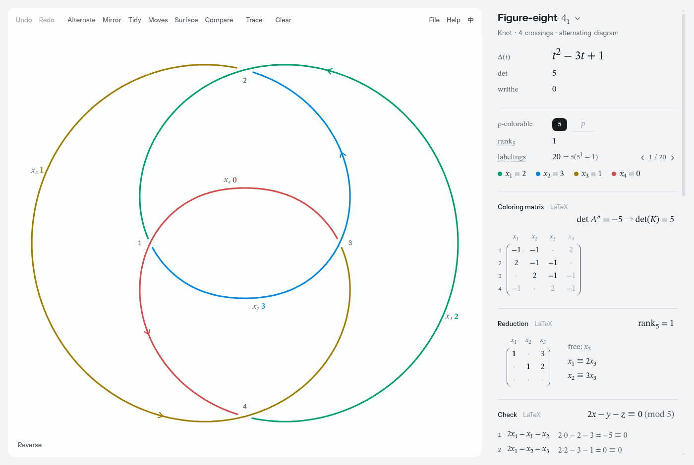

<div align="center">

# Knot Lab

**Draw a knot or link and read off its invariants.**

[](https://github.com/ZChenW/knot-lab/releases)
[](LICENSE)

English · [简体中文](README.zh-CN.md)



</div>

Knot Lab turns a drawing into mathematics. Sketch a knot or trace a picture, switch a crossing, and follow the invariants through the diagram and its matrices.

## Install

```sh
git clone https://github.com/ZChenW/knot-lab && cd knot-lab
pnpm install
./install.sh      # builds the app and installs it into ~/.local
```

You need Node.js with pnpm, Rust, and the system libraries Tauri uses. [Install](docs/install.md) covers those, updating, removing, and the single-file web version.

## Get started

1. Start **Knot Lab** from your application menu, or run `knot-lab`.
2. Drag on the board to draw a closed curve, or click the title on the right to pick an example.
3. Click a crossing to switch over and under, and watch the results change.

## Documentation

- [Install](docs/install.md): requirements, updating, uninstalling, the web version
- [Guide](docs/guide.md): drawing, tracing, the readings, moves, comparing knots, files, shortcuts
- [Surfaces](docs/surfaces.md): Seifert surfaces, disks with bands, triangulations
- [Conventions](docs/conventions.md): crossing signs, the matrices and how Δ(t) is normalised
- [File format](docs/file-format.md): the `.knot` file and the `window.knotLab` scripting interface

## Credits

Released under the [MIT License](LICENSE). Bundled fonts: [Instrument Sans](assets/licenses/Instrument-Sans-OFL.txt) and [STIX Two Text](assets/licenses/STIX-Two-Text-OFL.txt), under the SIL Open Font License.
